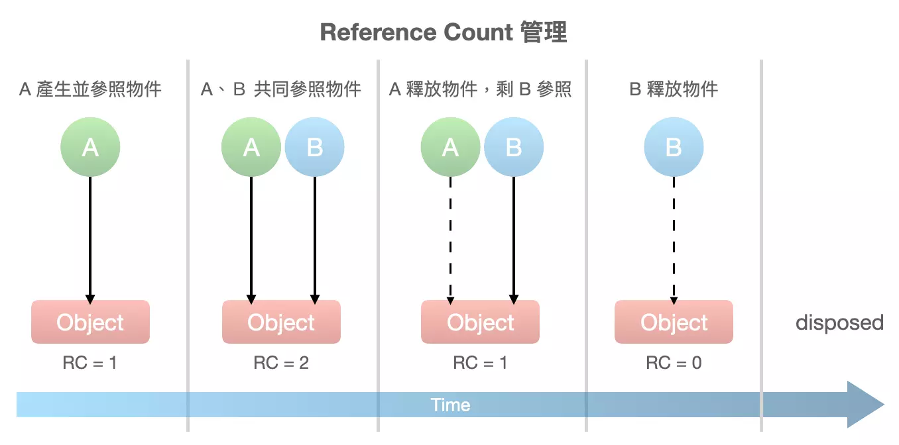

## Reference Counting

Reference Counting 是記憶體管理的方式之一：每個物件都記錄著「有多少個強參照（strong reference）持有它」。

- 多一個強參照持有這個物件，參照次數就 +1。
- 少一個強參照（例如變數被設成 `nil`、或離開作用域），參照次數就 -1。
- 參照次數變成 0 時，物件就會被釋放，它佔用的記憶體會被歸還。

如下圖：



要注意，只有「強參照」會讓次數增加。後面會提到的 `weak` 參照不會增加次數，這也是它能用來解決循環參照的原因。

有了基本觀念後，接著就分為手動管理記憶體（MRC）與自動管理記憶體（ARC）。

## 手動管理記憶體 Manual Reference Counting (MRC)

工程師自己寫程式，控制物件的參照次數。Apple 官方文件稱這種方式為 MRR（Manual Retain-Release）。

Objective-C 中，物件操作與對應的語法如下表：

| 物件操作 | Objective-C |
| --- | --- |
| 產生並持有物件 | 名稱以 `alloc` / `new` / `copy` / `mutableCopy` 開頭的方法 |
| 持有物件 | `retain` |
| 釋放物件 | `release` |
| 延後釋放物件 | `autorelease` |
| 廢棄物件 | `dealloc`（由系統呼叫） |

```objc
NSObject *obj = [[NSObject alloc] init]; // 自己產生並持有，參照次數 1
[obj retain];                            // 參照次數 2
[obj release];                           // 參照次數 1
[obj release];                           // 參照次數 0，系統自動呼叫 dealloc
```

要注意，**`dealloc` 不能自己呼叫**。參照次數歸零時，系統會自動呼叫它。在 MRC 下，我們只會在覆寫的 `dealloc` 裡，釋放自己持有的資源，並在最後呼叫 `[super dealloc]`。

手動管理時，常遇到的問題有：

- **閃退：release 非自己持有的物件。** 例如對一個不是用 `alloc` / `new` / `copy` / `mutableCopy` / `retain` 取得的物件呼叫 `release`，參照次數會提早歸零。
- **閃退：存取已經被釋放（dealloc）的物件。** 例如 release 的次數比持有的次數多，物件已經被釋放，之後再對它 release 或存取它，就會存取到無效的記憶體。
- **記憶體洩漏（memory leak）：忘了 release。** 參照次數永遠不會歸零，物件一直佔著記憶體。

## 自動管理記憶體 Automatic Reference Counting (ARC)

本質還是 Reference Counting，但改由**編譯器**在編譯時，自動幫我們在適當的位置插入 `retain` / `release`，工程師不用再自己寫。

ARC 和 Java 等語言的垃圾回收（Garbage Collection）不同：執行期間並沒有一個背景程序在掃描、回收物件。物件在參照次數歸零的當下就會被釋放，時間點是可預期的。但也因此，ARC 無法自動處理循環參照，需要工程師自己留意。

### Objective-C 的所有權修飾符

在 ARC 下，變數可以加上所有權修飾符，告訴編譯器這個變數要如何持有物件。沒有特別指定時，物件型別的變數預設是 `__strong`。

| 修飾符 | 說明 |
| --- | --- |
| `__strong` | 預設值。持有物件，參照次數 +1 |
| `__weak` | 不持有物件。物件被釋放後，變數會自動被設成 `nil` |
| `__unsafe_unretained` | 不持有物件。物件被釋放後**不會**被設成 `nil`，變成懸空指標，存取會閃退 |
| `__autoreleasing` | 把物件交給 autorelease pool，常見於 `NSError **` 這類參數 |

### 循環參照（Retain Cycle）

需要特別注意，如果物件之間透過強參照互相持有，例如 A 持有 B、B 又持有 A，參照次數永遠不會歸零，就會造成記憶體洩漏。循環不一定只有兩個物件，A → B → C → A 也一樣。

解法是讓其中一邊改用不持有物件的參照，所以 `__weak` 比起其他修飾符，更常出現在程式碼裡面。例如：

- 宣告 delegate 的時候：`@property (nonatomic, weak) id<MyDelegate> delegate;`
- 在 block 中使用 `self`：

```objc
__weak typeof(self) weakSelf = self;
self.completion = ^{
    [weakSelf reload];
};
```

### Swift 的寫法

Swift 也是使用 ARC，觀念完全相同，只是語法不同：

| Swift | 對應的 Objective-C | 說明 |
| --- | --- | --- |
| （預設，不用寫） | `__strong` | 持有物件 |
| `weak` | `__weak` | 不持有，物件釋放後自動變成 `nil`，所以必須是 optional 的 `var` |
| `unowned` | 類似 `__unsafe_unretained` | 不持有，也不是 optional。物件釋放後再存取會閃退，只適合「確定對方活得比自己久」的情況 |

宣告 delegate：

```swift
protocol DownloaderDelegate: AnyObject {
    func downloaderDidFinish(_ downloader: Downloader)
}

final class Downloader {
    weak var delegate: DownloaderDelegate?
}
```

在 closure 中使用 `self`，用 capture list 避免循環參照：

```swift
final class ProfileViewController: UIViewController {
    var onUpdate: (() -> Void)?

    override func viewDidLoad() {
        super.viewDidLoad()
        onUpdate = { [weak self] in
            self?.reload()
        }
    }

    func reload() { }
}
```

`ProfileViewController` 持有 `onUpdate` 這個 closure，如果 closure 又強參照 `self`，就會形成循環。加上 `[weak self]` 之後，closure 就不會持有 `self`。

---

## Deinitialization

實際開發時，其實沒有那麼多時間去觀察每一個資源有沒有被完整釋放。可以先在類別裡實作 `deinit {}`，印出某些字串。物件被釋放時，`deinit` 就會被呼叫；如果該釋放的時候沒有印出來，再去細看是哪裡未釋放，造成 memory leak。

```swift
deinit {
    print("ProfileViewController deinit")
}
```

找出是誰還持有物件，可以使用：

- **Xcode 的 Memory Graph Debugger**：App 執行中，點 Debug 列上的 Debug Memory Graph 按鈕，就能看到物件之間的參照關係，偵測到的洩漏物件會以紫色驚嘆號標示。
- **Instruments 的 Leaks**：在 App 執行過程中，持續偵測記憶體洩漏。

<a href="https://docs.swift.org/swift-book/documentation/the-swift-programming-language/deinitialization/" target="_blank">參考官方 Deinitialization 文件</a>

---

## 設定檔案為 ARC 或 MRC

ARC 是在 2011 年的 Xcode 4.2 開始支援，當時建立新專案時可以選擇要不要使用 ARC；之後的 Xcode 版本，新專案預設就是 ARC。現在應該是非常少的專案還在用 MRC 了，但維護舊程式碼、引入舊的第三方程式碼，或有時實驗性質，還是會需要修改。

ARC 是整個專案（Target）的設定，對應 Build Settings 中的 **Objective-C Automatic Reference Counting**（`CLANG_ENABLE_OBJC_ARC`）。如果只有個別檔案要不一樣，可以到 **Build Phases → Compile Sources**，在該檔案的 **Compiler Flags** 欄位加上：

- `-fobjc-arc`：對這個檔案**開啟** Objective-C ARC
- `-fno-objc-arc`：對這個檔案**關閉** Objective-C ARC

開頭的 `-f` 是 Clang / GCC 編譯選項的慣例，代表開啟某個功能；`-fno-` 則代表關閉。

---

## 參考資料

<ul>
  <li><a href="https://www.tenlong.com.tw/products/9781430241164" target="_blank">Pro Multithreading and Memory Management for iOS and OS X</a></li>
  <li><a href="https://docs.swift.org/swift-book/documentation/the-swift-programming-language/automaticreferencecounting/" target="_blank">Automatic Reference Counting</a></li>
</ul>
